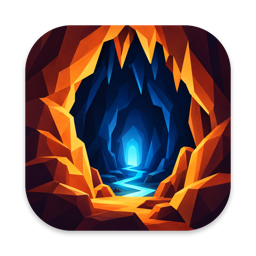
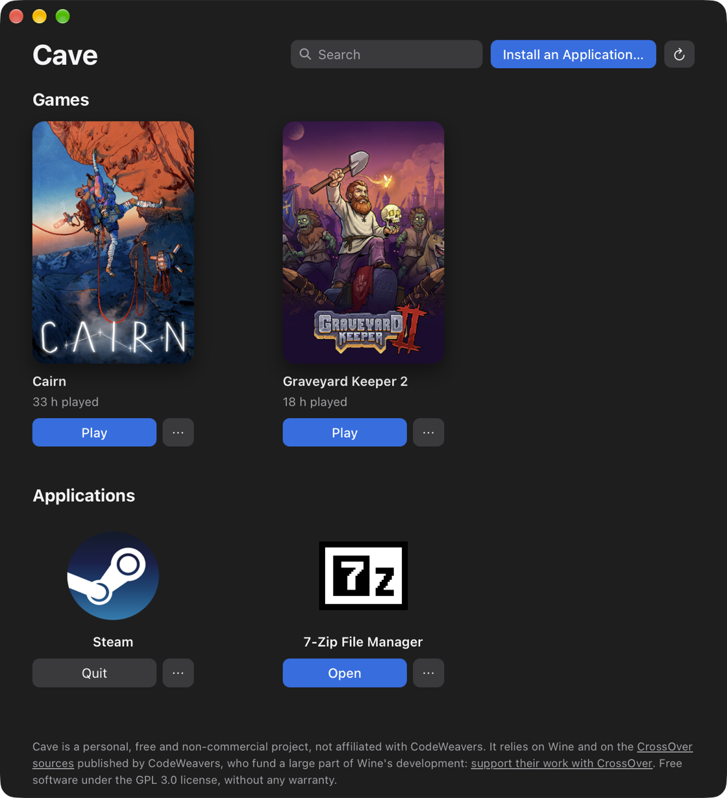

<p align="center">
  
</p>

<h1 align="center">Cave</h1>

<p align="center">
  <strong>Windows games and applications on your Apple Silicon Mac.</strong><br>
  A free, open-source Wine bottle manager, with its own Wine built from the CrossOver sources.
</p>

<p align="center">
  
  
  
</p>

<p align="center">
  
</p>

Cave installs Steam and Windows programs on a Mac and shows them as a simple library of games and applications. Each program lives in its own *bottle*, an isolated Windows environment, and Cave picks sensible settings for it: there is nothing technical to configure.

> [!NOTE]
> Cave is a personal, non-commercial project, **not affiliated with CodeWeavers**. It builds Wine from the [CrossOver sources](https://www.codeweavers.com/crossover/source) that CodeWeavers publishes under the LGPL, and benefits directly from the large share of Wine's development they fund. [CrossOver](https://www.codeweavers.com/crossover) adds support, a per-application compatibility database and game-by-game fixes: if Cave is useful to you, please support their work.

## Features

- **Steam in one click**: installs Steam and fixes its black window under Wine.
- **Your games, ready to play**: installed Steam games show up with their cover and playtime, and start with a click.
- **Any Windows application**: choose or drop an `.exe` or `.msi` installer, and the application shows up with its icon. Portable programs work too.
- **One bottle per program**: created in a fraction of a second, removed without a trace on uninstall.
- **Modern graphics**: Direct3D 10, 11 and 12 translated to Metal by D3DMetal or DXMT.
- **Microsoft components**: Visual C++, .NET and Microsoft fonts, installed from a tile's menu.
- **At home on macOS**: programs carry their own name in the Dock and come to the front when launched; the interface follows the language of macOS (English or French).
- **Up to date with CrossOver**: when CodeWeavers publishes a new version, a new runtime is built from its sources, and Cave offers it as an update.
- **A command line**, `cave`, for everything the interface does and more.

## Installation

You need a Mac with Apple Silicon and Rosetta 2, which runs Wine:

```sh
softwareupdate --install-rosetta --agree-to-license
```

1. Download `Cave.zip` from the [Releases page](https://github.com/brunet-guillaume/cave/releases).
2. Unzip it and move **Cave.app** to your Applications folder.
3. Open Cave. It is not signed by Apple, so macOS blocks the first launch: go to **System Settings → Privacy & Security** and click **Open Anyway**.
4. Cave downloads its runtime (about 280 MB) by itself from the same Releases page, and checks it. Offline, drop a downloaded `wine-cx-<version>.tar.xz` onto the window instead, or click **Choose File…**.
5. Install Steam or an application.

## Usage

### The app

| To… | Do this |
|---|---|
| Install a program | **Install an Application…**, or drag its installer onto the window |
| Install a plugin or a modding tool next to a program | Drag its installer onto that program's tile, or use **Install in This Bottle…** in the tile's menu |
| Start a game or an application | **Play** or **Open**; while it runs, the button becomes **Quit** |
| Change graphics, add components, see files and logs, uninstall | The tile's menu: **⋯** or right-click |
| Find something | **⌘F** |

### The command line

```sh
cave install ~/Downloads/npp.8.6.Installer.x64.exe   # install a program in a new bottle
cave launch npp notepad                              # start an application (part of its name)
cave create Steam && cave install-steam Steam        # install Steam in a new bottle
cave play Steam "baba is you"                        # start a Steam game (appid or part of its name)
cave components npp vcrun2022                        # install Microsoft components (no name: list them)
cave graphics Steam dxmt                             # Direct3D renderer: d3dmetal, dxmt or wined3d
cave list                                            # bottles (● running)
cave runtime install                                 # download and install the latest runtime
cave runtime update                                  # move to a newer published runtime
```

`cave --help` lists every command: bottles, runtimes, environment variables, logs…

## Building from source

You need Xcode's command line tools, [Homebrew](https://brew.sh), [Rust](https://rustup.rs), Rosetta 2, and [Gcenx's Wine Devel.app](https://github.com/Gcenx/macOS_Wine_builds/releases) in `/Applications` (its x86_64 libraries are used to build Wine).

```sh
brew install bison mingw-w64
rustup target add x86_64-pc-windows-msvc        # for the Steam shim
cargo install --path .                          # the cave command line

cave runtime build                              # build the Wine runtime (~20 min)
cave runtime add-dxmt wine-cx-26.3.0            # Direct3D 10/11 → Metal
cave runtime add-d3dmetal wine-cx-26.3.0 ~/Downloads/Game_Porting_Toolkit_3.0.dmg   # optional: DirectX 12
cave runtime add-winetricks wine-cx-26.3.0      # Microsoft components

cargo install tauri-cli --version '^2' --locked
cargo tauri build                               # → target/release/bundle/macos/Cave.app
```

- `cargo run -p cave-ui` starts the interface without building `Cave.app`.
- D3DMetal comes with Apple's [Game Porting Toolkit](https://developer.apple.com/download/all/?q=game%20porting%20toolkit) (free developer account).
- `scripts/package-runtime.sh` archives the runtime with its legal notices for a release.

## How it works

Cave is a Rust library shared by a command line and a [Tauri](https://tauri.app) interface. Its runtime, `wine-cx`, is Wine built from the CrossOver sources with mingw-w64 GCC, plus two small patches of ours, DXMT, D3DMetal, GStreamer and winetricks. New bottles are APFS clones of a template, applications are found through their Start Menu shortcuts, and a tiny shim fixes Steam's black window.

The details, from Steam's rendering to program names in the Dock, are in **[docs/how-it-works.md](docs/how-it-works.md)**.

## Limitations

- Games protected by anti-cheat software usually do not run.
- Microsoft Store apps are not supported.
- There is no per-application compatibility database like CrossOver's: some programs need a component or another renderer, chosen by hand.

## License

Cave is free software, released under the [GNU General Public License v3.0 or later](LICENSE), without any warranty. The Wine patches in `patches/wine` follow Wine's license, the LGPL 2.1 or later.

The runtime is built from, or bundles, these components:

| Component | License | Note |
|---|---|---|
| [Wine](https://www.winehq.org), from the [CrossOver sources](https://www.codeweavers.com/crossover/source) | LGPL 2.1+ | our changes are in `patches/wine` |
| [DXMT](https://github.com/3Shain/dxmt) v0.80 | MIT | official release |
| D3DMetal ([Game Porting Toolkit](https://developer.apple.com/games/game-porting-toolkit/)) | Apple license | not in this repository; redistributed for non-commercial use only (sections 2A(iii) and 2C) |
| [GStreamer](https://gstreamer.freedesktop.org) | LGPL 2.1+ | official macOS package |
| [Wine Mono](https://gitlab.winehq.org/wine-mono/wine-mono), [Wine Gecko](https://gitlab.winehq.org/wine/wine/-/wikis/Gecko) | MIT, MPL 2.0 | downloaded from WineHQ |
| [winetricks](https://github.com/Winetricks/winetricks), [cabextract](https://www.cabextract.org.uk) | LGPL 2.1+, GPL 3 | pinned versions |
| x86_64 libraries from [Gcenx's builds](https://github.com/Gcenx/macOS_Wine_builds) (gnutls, freetype, SDL2, MoltenVK…) | their own (LGPL, FTL, zlib, Apache 2.0…) | taken from Wine Devel.app |

Their notices ship with the runtime, in its `NOTICES/` folder and next to each component.

## Acknowledgements

Thanks to **CodeWeavers** for Wine, CrossOver and publishing their sources; to **Gcenx** for their builds and build recipes; to **3Shain** for DXMT; and to the [steam-on-m1-wine](https://github.com/notpop/steam-on-m1-wine) project for the idea of the Steam webhelper shim.
